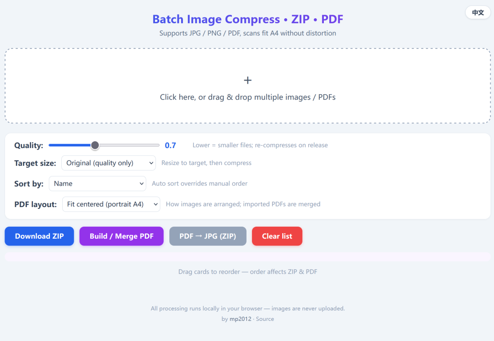

# image-compress-pdf

A pure front-end, locally-run tool to **batch compress images, pack them into a ZIP, and build a PDF** — all in a single `index.html`. No installation, no server required; just open it in a browser.

Chinese UI:

English UI:

## Features
- **Batch compression**: import JPG / PNG, adjust quality (0.1–0.95), re-compresses automatically on release.
- **Unified size**: resize every image to a target size before compressing, three modes:
  - Original (quality only)
  - Scale by long edge (enter long edge in px, no distortion)
  - Fixed W×H (fit with padding; identical output size, no distortion)
- **ZIP packaging**: download all compressed images as one ZIP.
- **Build / merge PDF**: powered by pdf-lib; merges images and PDFs in list order into a single file, with multiple layouts:
  - Fit centered (portrait A4, no distortion)
  - Smart auto orientation (landscape images use landscape A4)
  - Cover crop (no margin, may crop edges)
  - Original aspect ratio page (exact reproduction)
  - Multi-image grid (2×2)
  - Imported PDF files (including multi-page) are merged directly — "merge several PDFs into one".
- **PDF → JPG**: render each imported PDF page to JPG, named after the original PDF filename (single page uses the name as-is; multi-page adds `_1/_2…`), then download as ZIP.
- **Sorting**: drag cards manually / by name / by modified time — order affects ZIP, PDF and JPG export.
- **Remove single item**: click the "×" at the top-right of each card to drop an image or PDF you don't want to merge.
- **Bilingual UI**: switch between Chinese and English from the top-right corner.

## Usage
Open `index.html` in any modern browser. All processing happens locally; nothing is uploaded.

## Privacy
All image processing runs entirely in your browser. No images are ever uploaded to any server.

## Author
by [mp2012](https://github.com/mp2012) · Source
