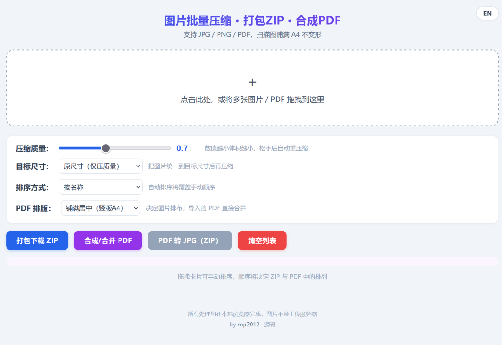

# image-compress-pdf

> English version: [README.en.md](README.en.md)

纯前端、本地运行的「图片批量压缩 · 打包 ZIP · 合成 PDF」工具。单文件 `index.html`，无需安装、无需服务器，双击即用。

## 功能
- **批量压缩**：导入 JPG / PNG，可调压缩质量（0.1–0.95），松开滑块自动重压。
- **统一尺寸**：在压缩前把图片缩放为统一尺寸，三种模式：
  - 原尺寸（仅压质量）
  - 按长边等比缩放（输入长边像素，不变形）
  - 固定宽高（等比留白，输出尺寸完全一致且不变形）
- **打包 ZIP**：一键将所有压缩图打包下载。
- **合成 / 合并 PDF**：基于 pdf-lib，按列表顺序把图片与 PDF 合并为一个文件，支持多种排版：
  - 铺满居中（竖版 A4，不变形）
  - 智能横竖自适应（横向图用横版 A4）
  - 裁切铺满（不留白，可能裁掉边缘）
  - 按原图比例页面（精确还原）
  - 一页多图拼版（2×2）
  - 导入的 PDF 文件（含多页）直接并入，实现「多个 PDF 合并成 1 个」。
- **PDF 转 JPG**：把导入的 PDF 逐页渲染为 JPG，按原 PDF 文件名命名（单页直接用原名，多页加 `_1/_2…` 编号），打包下载。
- **排序**：手动拖拽卡片 / 按名称 / 按修改时间，顺序同时影响 ZIP、PDF 与 JPG 导出。
- **移除单张**：每张卡片右上角「×」可删除不需要合并的图片或 PDF。
- **中英文界面**：右上角一键切换。

## 使用方法
用浏览器打开 `index.html` 即可。所有处理在本地完成，不上传任何服务器。

## 隐私
所有图片处理均在你的浏览器本地进行，不会被上传到任何服务器。

## 作者
by [mp2012](https://github.com/mp2012) · 源码
